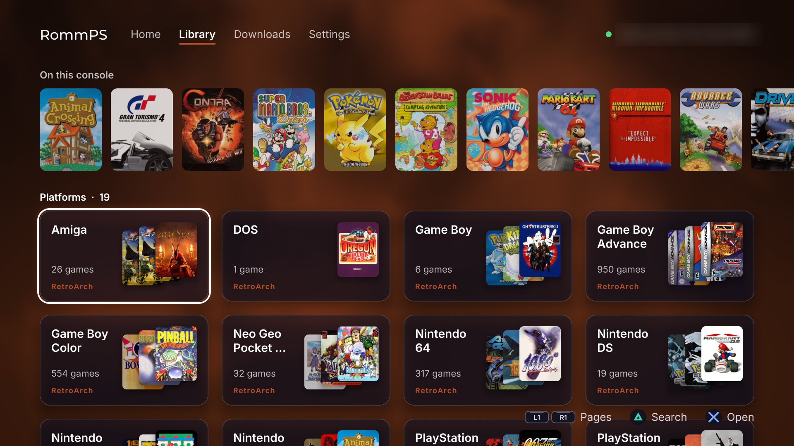

# RomM Server Client for PS4 and PS5



A [RomM](https://romm.app) companion client for jailbroken PS5 consoles (etaHEN or onionHEN, with kstuff) and PS4 consoles (GoldHEN). Through my insatiable need to mod everything electronic I encounter, I had my 12.70 PS5 jailbroken the minute that P2JB was out. I maintain a RomM server to centralize all my _legal_ ROMs, saves, and savestates, which all my devices sync with, and the PS5 needs similar treatment.

- **Save and state sync**
  - Monitors save file changes in the background, and uploads them as soon as they've changed. Periodic syncs also ensure that your PS4/5 always has the latest saves and save states.
  - A game's saves come down the moment it finishes downloading, so it's ready to play.
  - Save states only come down to an emulator that can load them (see [Save states](#save-states)).
  - Optional: turn save sync off in setup or Settings to use RomM just for games.
- **See what synced**
  - An activity log and every save and state kept in sync, by platform, in the app and the Web UI. Settle conflicts and restore older versions from either.
  - Settings > Diagnostic bundle saves the logs for a bug report, with your server, names and addresses left out.
- **Interactive library**
  - Browse your RomM library from the RommPS app (or some other device via the Web UI), download games and BIOS files into the right emulator folders, and resolve save conflicts.
- **Pluggable emulator profiles and multiple emulators per platform**
  - Fully customizable sync destinations, but includes frequently updated preset profiles for existing homebrew emulators. 
  - Can sync games and saves and states for multiple emulators per platform (PS2 on RetroArch and PS5SX2 as an example) using hardlinks.
- **Beautiful and Responsive UI**
  - Based on mihawk-99's Vulkan homebrew apps and BlackBearReloaded's UI kit, we get a nice, responsive feel. So worth it, it looks 1000x better. 15+ different themes to pick from.
- **Background Service**
  - All operations are handled by a backend payload, which means syncing, downloading, and updating keep working in the background, so you can keep **gaming**.
- **RomM API Compliant**
  - RommPS is meant to strictly stick to RomM's API and method of syncing saves and states, ensuring we don't break anything and support RomM's latest features.
- **Secure and Human-Coded**
  - Each release is signed. The payload checks the signature before it updates itself, and ProsperoStore checks every download against the release's checksum. This app was primarily coded by a **human**, and will be frequently updated and maintained. AI was primarily used for explaining concepts, creating documentation, and converting data. Ya know, the tedious stuff.
- **Easter Eggs**
  - Check in the Settings, scroll the settings list, see if you find the X. This **hint** won't be here forever.

## Requirements

- A PS5 running etaHEN or onionHEN, or a PS4 running GoldHEN
- RomM 5.2.0 or newer (may work on older versions)
- Whichever other emulators you want
  
## Install

### PS5

| ProsperoStore | RecompStore |
| :---: | :---: |
|  |  |

### Manual Install
Download `PPSA76677.zip` from the releases page, unzip it and copy the `PPSA76677` folder to `/data/homebrew/` on the console. Launch RommPS and it will deploy the background service, and set itself to autostart with etaHen or onionHen. 

If you'd rather run just the payload, without the app:
1. Download the latest `romm-sync.elf` from the releases page.
2. Send it to the console (or use whichever favorite tool you wish):
   ```sh
   nc -w 1 <ps5-ip> 9021 < romm-sync.elf
   ```
3. Set it up at `http://<ps5-ip>:8780` from another device.

### PS4

> **Experimental.** The PS4 is currently considered experimental
Needs GoldHEN 2.4b18.5 or newer, whose payload menu runs ELF payloads.
R
1. Download the latest `romm-sync-ps4.pkg` from the releases page and install it with your package installer.
2. Open **RommPS** from the home screen. It copies its payload, `romm-sync-ps4.elf`, to `/data/payloads/`.
3. In GoldHEN Settings, open the payloader, pick `romm-sync-ps4.elf` and run it. Add it to the AutoRun queue there and it starts on every jailbreak.
4. Open **RommPS** again: it shows the web UI. It's also at `http://<ps4-ip>:8780` from another device.

The app only installs the payload and shows the web UI; the payload does the syncing, in the background, whether or not the app is open. Without the package, copy `romm-sync-ps4.elf` to `/data/payloads/` yourself (GoldHEN's FTP server, or `make install-ps4 PS4_HOST=<ps4-ip>`).

**Note:** Don't send the payload to GoldHEN's network loader on port 9090: GoldHEN 2.4 crashes on ELFs sent there. Make sure the console's date and time are set (GoldHEN can keep them updated), or HTTPS won't work.

### How it runs

RommPS starts with your HEN, and setup turns this on for you. Both HENs start `payloads/romm-sync.elf` when `romm-sync.elf.auto_start` sits next to it, and RommPS puts both in every HEN's folder on the console (`/data/etaHEN/payloads` and `/data/OnionHEN/payloads`), so switching HENs keeps working. If a payload manager like pldmgr has its own copy, that copy is kept up to date too. If you build it yourself, `make install PS5_HOST=<ps5-ip>` copies it over FTP (add `PS5_FTP=ftp://<ps5-ip>:1337 PS5_HEN_DIR=/data/OnionHEN` for onionHEN's FTP plugin).

## Updates

- On the PS5, just update RommPS: from ProsperoStore (or other homebrew storefronts eventually), or by copying the new zip's folder over the old one. The background service comes with it, and RommPS swaps it in the next time you open it, once nothing is syncing or downloading. An older version never replaces a newer one. 
- On the PS4, the payload updates itself from Settings.

## Setup Wizard

The setup wizard walks you through five steps:

1. Connecting to your server.
2. Approving the console in RomM, by scanning a QR code or entering a code.
3. Choosing which emulators to sync.
4. Checking what the first sync will do.
5. Choosing when to sync in the background.

**Back up your saves before the first sync.** Copy your emulator save folders to a computer or USB drive. RommPS keeps a local copy before replacing any file, but your own backup is the safest option.

## Emulators
RommPS has built-in profiles for most known emulators on the PS5, and will set the correct default game, save/save state, and bios directories for them. Since there is a huge influx of new emulators popping up, I will be doing my very best to keep up with them and add profiles accordingly.  

Note: RommPS relies on your emulator **NOT** being sandboxed. Some emulators require a separate payload that must be launched to be able to access outside of the sandbox, so make sure you've followed their instructions to properly install. Sandboxed emulators will not be able to read games or save files.

> The emulators listed below are those I've tested and have created profiles for to auto-detect them. You can also manually set the directories for each emulator/platform via the PS5 app or or the Web UI; you can use whichever emulators you wish.

### PS5

| Emulator | Systems | Game Downloads | Saves | Comments |
| --- | --- | --- | --- | --- |
| [RetroArch](https://github.com/mihawk-99/PS5_RetroArch) | NES, Famicom Disk System, SNES, Game Boy, Game Boy Color, Game Boy Advance, Genesis/Mega Drive, Master System, Game Gear, Sega CD, SG-1000, arcade (FinalBurn Neo), PS2 (PS5SX2 on RetroArch 2.0, LRPS2 before it), PSP (PPSSPP), GameCube and Wii (Dolphin). Any other core you install for a system RomM knows (PS1, N64, Dreamcast, Saturn, 3DS and friends) gets picked up too | Full Support | Full Support | - |
| [PSXS5](https://github.com/SynoPiia/PSXS5) | PS1 | Full Support | One memory card per game, and states | States work with RomM's web player (PCSX-ReARMed or Beetle, whichever PSXS5 is set to) |
| [SwanStationPS5](https://github.com/darkxex/SwanStationPS5) | PS1 | Full Support | One memory card per game, and states | Plays PSXS5's games, keeps its own saves in `/data/SwanStationPS5`. Its states only load in SwanStationPS5 |
| PSSwanStation | PS1 | Full Support | One memory card per game, and states | Its states only load in PSSwanStation |
| [PS5SX2](https://github.com/Swordpdf/PS5SX2) | PS2 | Full Support | One memory card per game (the default), or its two shared cards backed up to RomM (5.3 or newer) | No save states yet |
| [Crux2](https://github.com/Press5elect/Crux2) | PS2 | Full Support | One memory card per game, the one Crux2 picks (games that share saves share a card), or its two shared cards; states | Uses `/data/crux2` when that folder exists. Its states only load in Crux2 |
| [PS5N64](https://github.com/Globaleliteee/PS5N64) | N64 | Full Support | Full Support | - |
| [PS5NES](https://github.com/Globaleliteee/PS5NES) | NES | Untested | Untested | Preset uses `/data/PS5NES/games` and `/data/PS5NES/saves`. GH page gone |
| PSFlyCast | Dreamcast | Full Support | Each game's own VMU; the shared VMUs are backed up as RomM memory cards | Save states don't sync yet |
| PS64 | Commodore 64 | Full Support | Save disks | Games save into their own disk images. No save states |
| PS5-ECAM | Wii U, 3DS, DS, Switch | Full Support | Wii U, 3DS, DS and Switch saves, 3DS and DS states | 3DS and DS states only load in PS5-ECAM. Switch saves are one player's, the same save as ProsperoEden's on RomM |
| [Porpoise](https://github.com/elripalda/Porpoise-Dolphin-Emulator-for-PS5) | Wii/GameCube | Full Support | N/A | Couldn't exit sandbox w/o crash. [Issue](https://github.com/elripalda/Porpoise-Dolphin-Emulator-for-PS5/issues/18) reported. Downloading games should work if the emulator is actually working for you.|
| XPSemu | Xbox | Full Support | Saves | Read from and written into its hard disk image, only while it's closed |
| [PS5X360](https://github.com/BrinooTk/PS5X360) | Xbox 360 | Full Support | Saves | The first signed-in player's saves; games go in `/data/xbox360`, a folder each |
| Seedee5 | Philips CD-i | Full Support | Saves and states | Each game's NVRAM is its save |
| [ProsperoEden](https://github.com/blackbearreloaded/ProsperoEden) | Switch | Full Support | Saves | One Switch user's saves (the first PS5 user's, unless set otherwise). Steps aside when ProsperoEden's own RomM sync is set up |
| Mednafen | PS1, NES, SNES, Game Boy, Game Boy Color, Game Boy Advance, Genesis/Mega Drive, Master System, Game Gear, PC Engine, Neo Geo Pocket, WonderSwan, Virtual Boy, Lynx | Full Support | Full Support | Built-in profile, off until you turn it on |
| PS2 ISOs (for PS2 FPKG tools) | PS2 | Full Support | Not synced | Downloads PS2 ISOs to a USB drive (`/mnt/usb0/ps2`) for PS2 FPKG tools. Off until you turn it on |

### PS4

| Emulator | Systems | Saves | Comments |
| --- | --- | --- | --- |
| RetroArch | The RetroArch systems above, wherever the PS4 build has the core | Saves and states | - |
| pSNES | SNES | Saves and states | - |
| pNES | NES, Famicom Disk System | Saves and states | - |
| pGEN | Genesis/Mega Drive, Master System, Game Gear, Sega CD, SG-1000 | Saves and states | - |
| pGBA | Game Boy Advance, Game Boy Color, Game Boy | Saves and states | Saves and states share its saves folder |
| pFBN | Arcade (FinalBurn Neo), Neo Geo Pocket (Color), ColecoVision, MSX, ZX Spectrum, SuperGrafx, Channel F | Saves and states | Arcade saves are the games' own memory (EEPROMs), backed up as they are |
| mGBA | Game Boy Advance, Game Boy Color, Game Boy | Saves and states | - |
| SNESUI | SNES | Saves and states | - |
| EmuSuNi | SNES, NES, N64 | Saves and states | Set its N64 folder to `/data/EmuSuNi/n64` in its settings |
| NPS64 | N64 | Saves and states | `.z64` dumps |
| DolphinPS4 | GameCube, Wii | Saves and states | - |
| Resonance | Dreamcast | Each game's own VMU, and states; the shared VMUs are backed up as RomM memory cards | - |
| PS4SX2 | PS2 | Its two shared memory cards, backed up to RomM (5.3 or newer) | No save states yet |
| Mednafen, PS2 ISOs | As on the PS5 | As on the PS5 | Built-in profiles, off until you turn them on |

### Save states
Some users have recently reported issues with being able to pull down save states from their servers. They don't see them on the destination save folder for that emulator, or if they do, they don't work. Save states typically cannot be used across different emulators (cores), and even within the same core, the definition of a save state may different with the file version, and version of the app. In my opinion, save states should be for quick resume or to save you when you forgot to save your game, so they truly don't need to be synced across devices.

### Memory cards
PS2 saves go up as one 8 MB card per game holding only that game's saves, which is what RomM's own [argosy-sigil](https://github.com/rommapp/argosy-sigil) makes, so Argosy and friends can load them. By default, RommPS gives each game its own card in PS5SX2 and RetroArch's PS5SX2 core (it writes the game's settings for you, no menu diving required), copies the game's saves over from the shared card, and leaves the shared card alone. Slot 2 stays shared, for the games that go looking for another game's save. Nothing on a card changes while the emulator is open.

PSP, GameCube and Wii saves are synced as one zip per game, the same format other RomM clients use.

## PS4/PS5 Games

If you are interested in downloading PS4 and PS5 games from your RomM server, RomM has direct FPKGi support, simply add it as a library. This sync client does NOT handle PS4/PS5 save syncing at this time, but is being researched for potential future inclusion.

## Web UI

RommPS exposes a separate Web UI at http://your-ps5-ip:8780 where you can access all the same features present in the native app.

## Emulator Profiles

I've included direct support for most of the emulators that are out right now, except for the ones that won't even launch... you can sync games, states, and saves anywhere you want, but the presets should do it for most people. You can also configure the paths for all platforms manually. The web UI has a JSON editor for emulator profiles.

## Building

```sh
make host tools       # macOS or Linux build for development, plus tools/release-sign
tools/ps5-build.sh    # PS5 build in Docker, output in build/ps5/
tools/ps4-build.sh    # PS4 payload in Docker, output in build/ps4/
tools/ps4-build.sh ps4-pkg   # plus the PS4 home screen app (platform/ps4/app)
tests/e2e.sh          # end-to-end tests against a mock RomM server
tests/autostart.sh    # autostart, version checks and HEN folders
```

Both consoles build from the same code in `src/`. What differs lives in `platform/<console>/`: `platform.c` (the `src/platform.h` interface), the make rules and the Docker SDK image. `platform/console/` has the parts the PS4 and PS5 share, and `platform/host/` is the development build.

## P.S to the industry

If buying isn't **owning**, then piracy **isn't** stealing. 🖕

## Shameless Plug

<a href='https://ko-fi.com/M7G128GENT' target='_blank'></a>

## License

GPL-3.0. Parts of the console code are adapted from [ftpsrv](https://github.com/ps5-payload-dev/ftpsrv) and [websrv](https://github.com/ps5-payload-dev/websrv) by John Törnblom. [cJSON](https://github.com/DaveGamble/cJSON) and [qrcode-generator](https://github.com/kazuhikoarase/qrcode-generator) are MIT licensed. [Monocypher](https://monocypher.org) is CC0 or BSD-2-Clause. [argosy-sigil](https://github.com/rommapp/argosy-sigil) is MPL-2.0, with [tiny-AES-c](https://github.com/kokke/tiny-AES-c) (Unlicense).
